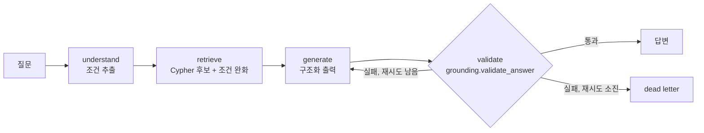

# ADR-0011. 배치 생성에서 질의형 GraphRAG 로: 조건을 그래프 어휘에 묶고, 검증 실패는 재생성

- 상태: Accepted
- 날짜: 2026-11-03
- 프로젝트: VCC
- 코드: `GragpRAG/ask_graph.py`, `app/ask_api.py`, `GragpRAG/eval_ask.py`

## 맥락

주간 배치(`graphrag_aq.py`)는 질문 6개를 코드에 고정해 두고 답을 미리 만든다.
사용자가 "여름에 시원하게 마실 음료"를 물으면 답할 경로가 없다.

질문을 받으려면 질문에서 그래프 검색 조건(태그·계절·종류)을 뽑아야 한다.
기존 `candidates.parse_question` 은 문자열 규칙이다. 그래프 어휘와 대조해 보니 두 가지가 걸렸다.

1. 규칙이 내는 태그 `단맛`, `비주얼`, `트렌디` 는 그래프에 없는 값이다. 그래프의 Tag 는
   `달콤함`(60개 키워드), `부드러움`(55), `상큼함`(14) 같은 40종이다.
   이 태그가 걸리면 Cypher 결과가 0건이 되고 빈도순 상위 10개로 떨어진다.
2. 규칙에 없는 표현("달달한", "새콤한", "짭짤한")은 조건을 하나도 못 뽑는다.

## 결정

LangGraph 로 고정 단계 워크플로를 만든다.

| 노드 | 하는 일 | 근거 |
|---|---|---|
| understand | LLM 이 조건을 뽑는다. 출력 스키마의 enum 을 **그래프에 실제 있는 Tag/Season/Category 값으로 실행 시점에 만든다.** 실패하면 규칙 파서로 떨어진다 | 그래프에 없는 조건은 스키마상 만들 수 없다 |
| retrieve | 조건으로 Cypher 를 만들고, 후보가 3개 미만이면 종류 → 계절 → 맛 순으로 조건을 푼다 | 프롬프트가 3~5개를 요구한다. 후보 1개면 모델은 후보 밖에서 채울 수밖에 없다 (실측: "여름에 시원하게 마실 음료" 가 후보 1개 → 3회 모두 후보 밖) |
| generate | `generate.py` 의 같은 프롬프트, 구조화 출력 | 배치·서비스·모델 비교가 같은 생성 함수를 쓴다 |
| validate | `grounding.validate_answer` (lenient) | 판정 기준의 단일 출처 |
| 재생성 | 실패 사유(`ungrounded:망고`)를 프롬프트에 넣어 최대 2회 | 배치는 격리만 했고 재처리는 다음 회차에 의존했다 |

검증을 통과하지 못한 답은 API 가 200 으로 돌려주지 않는다 (422 + 사유).

## 기각한 대안

| 대안 | 기각 이유 |
|---|---|
| 규칙 사전 확장 | 표현 수만큼 규칙이 늘고, 그래프 어휘가 바뀔 때마다 규칙을 같이 고쳐야 한다. enum 을 그래프에서 읽으면 어휘 변경을 코드가 따라간다 |
| ReAct 에이전트(도구 선택을 모델에 맡김) | 단계 순서가 고정된 흐름이다. 모델이 순서를 고를 이유가 없고, 고르게 하면 검증 단계를 건너뛰는 경로가 생긴다 |
| Text2Cypher (LLM 이 Cypher 작성) | 쿼리 자체가 검증 대상이 된다. LLM 은 조건만 뽑고 Cypher 는 코드가 만든다 |
| 임베딩 유사도로 태그 매칭 | 별도 모델과 임계값 튜닝이 필요하다. LLM 조건 추출을 먼저 재고, 부족하면 검토한다 |

## 측정

조건: qwen2.5:7b (Ollama 0.40.14 docker, RTX 4070 SUPER), temperature 0.3, Neo4j 5.15 (Keyword 337).
라벨 판정자는 Claude 다. 사람 교차검증이 없다 (`annotator` 필드).

### 조건 추출 정확도 (질문 단위, 네 필드 모두 정답)

| 방식 | 개발셋 20문항 | 홀드아웃 15문항 |
|---|---|---|
| 규칙 파서 | 3/20 (15.0%) | 3/15 (20.0%) [7.0, 45.2] |
| LLM v1 (선택지를 스키마에만) | 17/60 (28.3%) | - |
| LLM v2 (선택지를 프롬프트에도) | 59/60 (98.3%) | **36/45 (80.0%) [66.2, 89.1]** |

- v1 은 태그를 거의 고르지 않았다 (태그 정답 26/60, 대부분 빈 목록). 선택지 40개가 스키마에만 있었다.
- v2 의 규칙은 개발셋에서 v1 이 틀린 사례를 보고 썼다. 그래서 개발셋 98.3% 는 과적합을
  가릴 수 없고, **v2 를 쓴 뒤에 새로 만든 홀드아웃 15문항의 80.0% 를 대표값으로 쓴다.**
  프롬프트 예시와 겹치는 표현은 홀드아웃에 넣지 않았다.
- 홀드아웃 오답 예: "짭짤한 빵" → `매콤함, 달콤한` (정답 `소금맛`).
- 조건 추출 지연 p50 0.53s / p95 0.69s (45회).

원본: `eval/ask_conditions_20261103_181346.json`(v1), `_181518.json`(v2 개발셋), `_181619.json`(v2 홀드아웃).

### 질문 → 답변 전체 (35문항 × 3회 = 105쌍)

대조군은 규칙 파서 + 재시도 없음이다. 배치와 같은 동작이다.

| 지표 | 대조군 | 질의형 | 비고 |
|---|---|---|---|
| 최종 검증 통과 | 95/105 (90.5%) [83.4, 94.7] | **102/105 (97.1%)** [91.9, 99.0] | 쌍체 McNemar p=0.065, **이 표본에서 유의하지 않다** |
| └ 첫 시도 통과 | 95 | 92 | |
| └ 재생성으로 회복 | 0 | 10 | |
| 조건이 하나도 안 걸린 후보 | **81/105 (77.1%)** | **28/105 (26.7%)** | 메뉴 경로에서 질문과 무관한 빈도순 상위 |
| 지연 p50 / p95 | 2.20s / 3.76s | 2.91s / 6.35s | p95 증가는 재생성 |

- 대조군 실패 10건은 전부 `ungrounded` 이고, 후보가 전부 빵(`소금 빵`, `크림 빵` ...)인데
  질문이 음료("커피 향이 진한 음료", "새콤한 과일 음료")인 경우다. 후보가 질문과 맞지 않으면
  모델이 후보 밖에서 답을 만든다. 후보를 질문에 맞추는 것이 생성 단계의 위반을 줄이는 방향이다.
- 통과율 차이는 방향은 맞지만 p=0.065 다. 질문 수를 늘려 다시 재기 전에는 "통과율이 올랐다"고
  쓰지 않는다. 확실히 말할 수 있는 것은 **후보가 질문 조건을 반영한 비율**(77.1% → 26.7% 무조건 후보)이다.

원본: `eval/ask_e2e_20261103_182638.json` (질문셋은 개발셋 + 홀드아웃 연결).

## 한계

- 그래프가 희소하다. Season 이 걸린 Keyword 는 337개 중 23개, `따뜻함` 태그는 1개다.
  "겨울에 어울리는 따뜻한 음료" 는 조건을 다 뽑아도 후보가 3개를 못 넘어 전부 풀린다.
  AND 조건을 하나씩 푸는 대신 **조건 일치 개수로 점수를 매기는 단일 쿼리**가 다음 개선 후보다.
- 라벨이 Claude 단독이고 문항이 35개다.
- 모델 1종(qwen2.5:7b) 기준이다.
